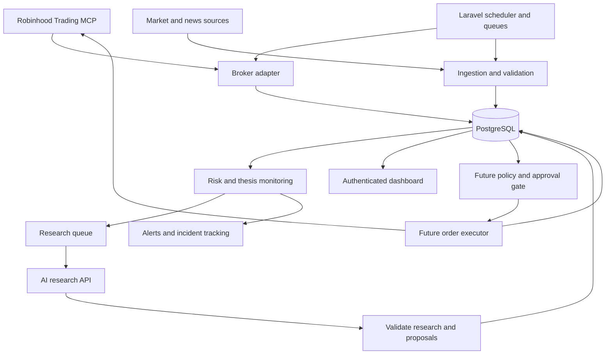

# End-to-end implementation plan

Status: proposed implementation baseline, October 16, 2026. Read [the index](README.md) for owner decisions and [the checklist](DEVELOPMENT-CHECKLIST.md) for work sequencing.

## 1. Product objective and release boundaries

Build an always-on local application that maintains reliable portfolio state, monitors investment theses and operational failures, organizes research, and eventually manages bounded execution. Optimize for auditability, dependable follow-through, and useful decisions rather than trade frequency.

Release 1 comprises broker reads, complete snapshots, deterministic risk observations, persistent theses, selective AI research, a secured dashboard, alerts, and tested recovery. Release 2 adds realistic shadow/paper evaluation. Release 3 adds explicitly enabled execution for a specified account and strategy. Operational reliability is not evidence of profitable strategy performance.

The personal investing account remains advisory. The agentic account is the only candidate for future automation, determined by current broker eligibility and operator account binding. Strategy sleeves are labels within the portfolio ledger, not assumed brokerage subaccounts. A long-term holding must not inherit swing-trading exits merely because the same ticker is present in both sleeves.

Non-goals for the first release: high-frequency trading, predictive ML training, options, leverage, crypto expansion, autonomous risk-limit increases, public internet hosting, and a rewrite of the application in Python.

## 2. Existing implementation: reuse and repair

| Existing component | Treatment |
|---|---|
| Broker accounts, assets, positions, orders, decisions and risk records | Reuse where semantics fit; add account scoping, snapshot completeness, and provenance |
| Coinbase and Robinhood Crypto clients | Preserve as separate adapters; disable their scheduled dispatch in the new runtime unless explicitly enabled |
| Queue/scheduler foundation | Reuse with distinct queues, timeouts, deduplication, health tracking, and recovery |
| Risk and strategy services | Extract reusable calculations; do not carry crypto thresholds or signals into equities |
| Paper trading components | Audit before reuse; simulate realistic lifecycle rather than treating submission as a fill |
| Research/backtest models | Reuse records; current `BacktestOrchestrator` records supplied metrics and is not evidence of a working replay engine |
| API and approval controller | Add authentication and policies; replace caller-supplied approver identity with authenticated identity |
| Live execution service | Replace unsafe agentic reuse: current code calls broker before creating its local order record and lacks atomic submission ownership |
| Database configuration | Support `mcp_trading` search path, verify it before migration, add PostgreSQL integration tests |

The roadmap does not assert the existing tests pass. Establish that baseline in M0. Do not install a framework upgrade as part of the pivot.

## 3. Target architecture

### Runtime choices

- Laravel 12 on PHP compatible with `composer.lock`; Nginx routes only to `public/index.php` through PHP-FPM.
- PostgreSQL stores business state, queues, sessions, and cache initially. Redis is not a prerequisite.
- Blade, existing Tailwind, and small JavaScript components are the default UI. Avoid adding a second frontend application for this scope.
- A single scheduler dispatches work. Dedicated monitoring/reconciliation workers cannot be starved by slow AI requests. Use queues `monitoring`, `research`, `notifications`, and later `execution`.
- Keep the broker transport behind an interface. M1 attempts a maintained PHP MCP client supporting the broker's negotiated protocol and OAuth flow. If a suitable implementation cannot pass the spike, use a small Python sidecar in this repository with a maintained MCP SDK. Record that decision before expanding it.
- The optional sidecar binds only to loopback, requires a local service token, owns transport/session handling only, and exposes normalized operations. Laravel remains the sole business-state writer. The bridge never receives arbitrary model-generated tool names to execute.
- The application is an MCP **client** of Robinhood. Building a custom MCP server for ChatGPT to query this application's research is a later optional feature, not a prerequisite.

## 4. Integration contracts and capability discovery

### Broker adapter

Define typed domain DTOs and a `BrokerGateway` contract for account discovery, portfolio, paginated positions, paginated orders, instruments, quotes, and supported cash-flow/history reads. Keep review/submit/cancel in a separate execution contract, unavailable to Release 1 workers.

Every read returns `source`, `retrieved_at`, `source_as_of` when supplied, `completeness`, continuation information, and normalized records. Unsupported operations raise an explicit capability error. Authentication failure, rate limit, stale data, partial pagination, and malformed data are distinct errors.

Discover tools and schemas from the actual authorized MCP connection. Persist a sanitized capability manifest and schema fingerprint for contract testing. On a breaking schema change, disable affected operations and surface an incident; never guess new order parameters.

Use Robinhood's documented MCP endpoint `https://agent.robinhood.com/mcp/trading`. A connection from this app needs its own supported authorization flow. Do not copy browser tokens or assume the ChatGPT connector's authorization transfers to the application. Discover OAuth metadata; validate state, PKCE, redirect URI, scopes, and token audience as required by the negotiated protocol. Serialize refresh operations and securely persist rotated tokens. A revoked refresh token requires operator reconnect, not repeated login attempts. [Robinhood onboarding](https://robinhood.com/us/en/support/articles/agentic-trading-overview/), [MCP authorization](https://modelcontextprotocol.io/specification/latest/basic/authorization).

M1 must prove whether this application's connection can access the existing desired agentic account. If account binding or approval capabilities differ, record the constraint; do not automatically create a replacement account or silently switch brokers.

### Market and news adapter

Define `MarketDataProvider` for timestamped quotes, market sessions, corporate actions, daily bars, fundamentals, earnings dates, and news. Record per-field coverage and freshness; a vendor may support only part of this contract. Start with broker-supported reads, then select one paid source only after testing coverage and budget. No vendor subscription is authorized by this document.

Store exchange sessions with holiday and early-close support. Use `America/New_York` for U.S. trading sessions and `America/Chicago` for the owner's display preference; store timestamps in UTC. Missing session coverage means no future trading, not an assumed weekday schedule.

### AI research adapter

Use a configurable model via an application API credential. Codex in VS Code is the development assistant, not the unattended production process. Do not assume a ChatGPT subscription supplies application API capacity.

The request contains a bounded, timestamped portfolio summary, existing thesis version, triggering event, relevant source excerpts, and allowed research task. It omits credentials and full brokerage identifiers. The response must validate against a strict schema: thesis assessment, material facts with source references/as-of times, uncertainties, candidate or WAIT, catalyst, risks, horizon, invalidation, and review time. Store model ID, prompt version, request context fingerprint, usage, cost estimate, and completion status. Structured output constrains format; application checks still decide validity. [OpenAI structured outputs](https://developers.openai.com/api/docs/guides/structured-outputs).

Reject unsupported symbols, invented source IDs, missing timestamps, malformed fields, and execution instructions embedded in research. Allow one bounded repair attempt for output format, then record failure. Treat a model refusal or timeout as research unavailable. No model receives broker mutation tools or configuration-write tools.

## 5. Persistence and data quality

Extend existing tables where meaning matches; avoid duplicate ledgers for the same fact. Add the following logical entities through additive migrations:

| Entity | Required information and constraints |
|---|---|
| Integration connection | Provider, authorized account binding, capabilities, token expiry, health; encrypted secrets stored separately from public metadata |
| Monitoring run | UUID, trigger, scheduled/actual time, status, step progress, error, policy version; non-null unique ID generated by code |
| Complete account snapshot | Account, equity/cash/buying power, positions/orders snapshot IDs, source/retrieval times, pagination/completeness, reconciliation state |
| Account policy version | Account, mode, limits, allowed instruments, approval settings, actor, effective time; immutable version history |
| Strategy sleeve and allocation | Account, long-term/active/unclassified, cash budget, attributed quantity, allocation history |
| Thesis and thesis version | Instrument/sleeve, rationale, sources, catalyst, entry conditions, explicit invalidation type, horizon, next review, status |
| Research event/run | Deduplication key, source event, result, model/prompt version, evidence, costs |
| Cash-flow event and performance snapshot | Broker evidence, external/internal flow classification, event time, units/NAV, confidence and benchmark basis |
| Incident and notification delivery | Severity, stable key, first/last occurrence, state, acknowledgement, delivery attempts and escalation |
| Future order intent and executions | Account, immutable payload hash, stable client reference, policy/snapshot references, approval evidence, state, broker IDs, unique execution IDs |
| Outbox event | Transactionally committed work/notification intent, unique event ID, attempt state, dispatch timestamp |

Use PostgreSQL numeric columns and decimal strings in APIs. Implement explicit decimal arithmetic/rounding; float conversions in existing services must not enter financial decision paths. Use UTC timestamps with explicit semantics. Validate finite positive values where required, distinguish null from zero, and reject impossible bid/ask or quantity combinations.

A snapshot is complete only when all required pages have been retrieved. Stage incoming data and publish the completed snapshot atomically. A missing position can be closed only from a complete successful reconciliation, never from a failed/empty partial response. Keep previous valid data visible but label it stale.

If the same instrument belongs to both sleeves, preserve attributed quantities and cash movements in a sleeve ledger. Their sum must reconcile to the broker position, with an explicit unclassified residual for unexplained differences. Do not invent historical attribution during import.

## 6. Monitoring and scheduling

Proposed starting cadence, configurable within provider limits:

| Job | Cadence | Behavior |
|---|---|---|
| Account/position/order sync | Every 5 minutes during regular session; hourly outside | Complete snapshots, freshness, reconciliation |
| Open-order reconciliation | Every minute while orders are unresolved and service available | Read-only, including manual orders; never assume timeout means rejection |
| Held/watchlisted quote checks | Every 5 minutes during session | Evaluate stored numeric conditions; timestamps visible |
| News/earnings ingestion | Every 30 minutes during session; once before open | Deduplicate source events and schedule material research |
| Daily review | Before open and after close, market-calendar aware | Existing holdings first, then candidate screen |
| Weekly review | Friday after close, or last session of week | Returns, costs, missed opportunities, thesis adherence |
| Process heartbeat | Every minute | Independent uptime service alerts after 10 minutes missing |

This is polling with event-triggered work downstream. WebSockets are optional later if measured requirements justify them. No promise of continuous protection or execution at an observed threshold.

Each trigger has a stable deduplication key. Overlapping scheduled work coalesces. A missed session is recorded, not replayed as old trade decisions. On startup, reconcile account/orders, validate calendar and freshness, then resume monitoring; stale trading proposals expire.

Use bounded retry/backoff for idempotent reads, respecting provider rate limits and `Retry-After`. Distinguish transient failures from authorization and validation failures. Circuit-break persistently failing integrations. Persist progress so research failure does not erase a valid account snapshot.

## 7. Risk policy and operating modes

Maintain separate `research_enabled`, execution mode (`disabled`, `paper`, `approval_required`, `bounded_auto`), and durable pause reasons. `disabled` is the default. Research may continue during a trading pause. An emergency execution disable blocks all new broker mutations; a daily buy pause blocks buys but does not imply a liquidation or cancellation.

The prior task protocol supplies candidate migration limits, not fresh authorization. Preserve them as a disabled policy draft until compared with valid current controls and approved for the relevant account:

| Draft rule | Historical value |
|---|---|
| Maximum purchase | $100, never a target |
| Company / sector-theme / speculative exposure | 25% / 35% / 10% of account equity |
| Gross equity/ETF exposure / cash reserve | 90% / at least 10% |
| Session gross buys | Lesser of $200 or 40% of first verified session equity |
| Session buy count / same-symbol cooldown | 3 logical orders / 60 minutes |
| Planned loss to explicit invalidation | At most 2% of account equity; not a guaranteed maximum loss |
| Daily flow-adjusted NAV pause / peak drawdown review | 5% / 15% |
| New-entry quote age / account refresh before submit | 60 seconds / 120 seconds |
| Maximum spread relative to midpoint | 0.5% |

Count manual activity, pending commitments, uncertain submissions, and cross-sleeve exposure. Do not double-subtract buying power already reserved by the broker. Sales do not replenish a gross-buy budget. Existing breaches generate incidents and prevent additions; they do not automatically trigger sales. Unknown ETF overlap is flagged, not assigned zero exposure.

Separate long-term thesis deterioration from ordinary price moves. Invalidation types include price, completed-session close, earnings/fundamental event, and manual review. Only numeric conditions supported by verified data can be evaluated deterministically; fundamental judgments require evidence review. An intraday dip is not a completed-session close breach.

Before live activation, resolve sleeve allocations, eligible universe, entry/exit rules, sizing, order type/rounding, and approval requirements. No automatic live activation after a small number of successful test runs.

## 8. Future execution and recovery design

Use durable lifecycle states: `PREPARED`, `AWAITING_APPROVAL`, `READY`, `SUBMITTING`, `SUBMITTED`, `PARTIAL`, `FILLED`, `CANCELLED`, `REJECTED`, `UNKNOWN`, and `EXPIRED`. Define an allowed transition table and retain every transition event.

1. Commit an immutable intent, one UUID client reference, payload hash, risk evidence, and outbox event in one database transaction.
2. Bind required approval to that exact payload/version, expiry, and authorized actor/broker approval record. Material changes require new approval.
3. Serialize execution per account. Use a dedicated account advisory lock held on a dedicated database connection through final checks and the external request; use short row transactions for state changes. Lock loss prevents further dispatch. A persisted `SUBMITTING`/`UNKNOWN` intent blocks competing submissions even if a process dies and its advisory lock releases.
4. Re-read current operating policy, account eligibility, complete portfolio/orders, quote, session, available funds and approvals. Persist `SUBMITTING` before making the external call.
5. Send only the saved payload and stable reference. A timeout, crash, or missing response becomes ambiguous until reconciled. No generic queue/HTTP retry may repeat a write without the adapter's verified idempotency and recovery rules.
6. Record broker response and executions. An accepted order is not a fill. Reconcile partial fills/cancellations with unique execution IDs and cumulative quantity consistency.
7. After an ambiguous outcome, query by broker ID/reference and history. Absence from one response is inconclusive. Escalate if unresolved; never generate a new UUID to retry the same order.

Do not claim exactly-once delivery across the network. Enforce durable intent, serialized dispatch, broker-supported deduplication, and conservative reconciliation. Do not hold a SQL transaction open for AI research. Notifications and optional Sheets exports use an outbox so failures cannot corrupt order state.

## 9. Research, performance, and cost

Use a broad but bounded liquid U.S. stock/ETF universe, with existing holdings first. Record the strongest candidate and alternative/WAIT condition. Cache unchanged research; trigger a new review on material events or expiry, not every quote poll. Initial research limit: at most one active run per instrument/thesis version and event fingerprint.

Maintain return calculations separately from deposits/withdrawals. Unitize using verified flow timing and contemporaneous valuations. Unknown flows make affected returns/drawdown gates unavailable; show the last verified calculation and reason. Fees and distributions are classified, not mistaken for external deposits. Compare like-for-like timestamps and identify VTI price return versus total return. Do not annualize short samples or present self-reported model confidence as calibrated win probability.

Budget design: target $100/month, maximum envelope $150 including fixed subscriptions. Reserve expected API cost before dispatch, reconcile actual usage afterward, and track outstanding reservations atomically. Reject optional calls when reservations would exceed the remaining allocation. Fixed subscriptions can consume the envelope even with zero API usage; require a reviewed provider-cost configuration. At 80% of the envelope, notify and reduce optional research. Broker sync and local risk checks continue when AI spending stops. Provider-side limits supplement the application ledger; delayed billing means an absolute invoice guarantee is not possible.

## 10. Dashboard and alert behavior

Provide six views: Overview, Holdings/Theses, Research/Watchlist, Decisions/Orders, Performance, and System Health/Settings. Show data age and source, operating mode, account scope, sleeve attribution, incident severity, and clear unknowns. Show simulation labels prominently. Authentication is required; account IDs are masked in views/logs. State-changing routes require authorization and CSRF protection. No open registration.

Use an in-app incident inbox plus one configured external delivery adapter. Send immediate alerts for unknown orders, auth failure, stale critical data, breached thesis conditions, and unhealthy services. Deduplicate persistent alerts; repeat urgent unacknowledged incidents after 30 minutes. Routine HOLD results go into a daily digest. The independent heartbeat service must work when the Mac or internet connection is unavailable. Do not report an alert delivered without provider acknowledgement.

## 11. Migration from ChatGPT/Sheets

Import from an operator-provided export first; direct read-only Sheets access is optional. Map Bot Control to a disabled policy draft, Check Log to run history, Decision Log/Trade Ledger to sourced thesis/order history, Performance Log to historical snapshots, and Opportunity Review/System Health to research/incidents.

Keep immutable source file hashes and source row references. Deduplicate imports and produce a validation report. Quarantine missing/`undefined` IDs, contradictory fills, and unknown flows. Generated import IDs must never be represented as original broker references. Historical thresholds do not authorize future trading.

Reconcile current holdings and open orders from live broker reads before using imported state operationally. Leave unresolved sleeve assignments and old baseline accounting explicitly unknown. Preserve the original archive. Never silently clear a legacy lock or repair old spreadsheet rows as a side effect of import.

At cutover, have the operator verify legacy ChatGPT trading tasks are paused and no other executor is active. The app should show this as a recorded operator prerequisite; it cannot prove exclusive control of all external clients. No dual execution during migration. Sheets export failure must never block local monitoring.

## 12. Delivery and release gates

Follow M0–M6 in the checklist. Release 1 requires M0–M4, seven consecutive trading sessions of unattended monitoring, no missing/duplicate run identifiers, complete snapshot reconciliation, verified external alert delivery, and a successful backup restore and forced worker restart drill. Record all gaps; restart the proving window after a material reliability defect.

M5 validates simulated execution and strategy evaluation. M6 requires explicit owner live settings and broker approval support, clean order state, an emergency-disable drill, and fault-injection tests. A successful monitoring week is not permission to trade or proof of investment edge.

## 13. Source references and verification date

Architecture and thresholds above are project design decisions. External protocol/service details must be checked again when implementing:

- [Laravel 12 deployment](https://laravel.com/docs/12.x/deployment)
- [Laravel 12 queues](https://laravel.com/docs/12.x/queues)
- [PostgreSQL schemas and search path](https://www.postgresql.org/docs/current/ddl-schemas.html)
- [Robinhood external-agent onboarding](https://robinhood.com/us/en/support/articles/agentic-trading-overview/)
- [MCP authorization](https://modelcontextprotocol.io/specification/latest/basic/authorization)
- [OpenAI structured outputs](https://developers.openai.com/api/docs/guides/structured-outputs)
- [Codex AGENTS.md instructions](https://developers.openai.com/codex/guides/agents-md/)

Checked October 16, 2026. Installed package and negotiated protocol versions, not the newest documentation alone, determine implementation compatibility.
