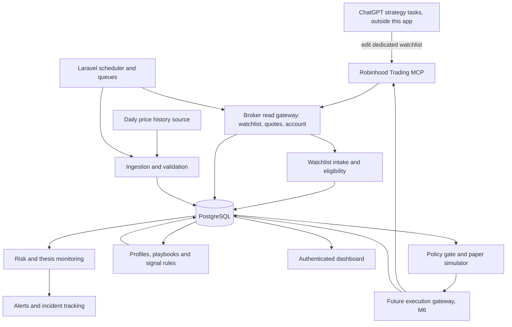

# End-to-end implementation plan

Current application update, October 18: authenticated Control Center forms applied mandate v1 / policy revision 1 / execution v2, with one $500 virtual opening balance and the 44-symbol allowlist. Read-only PostgreSQL verification confirms encryption, exact prepared values and zero execution activity. All AI/paper/live gates remain off. This resolves the earlier browser/settings blocker recorded below; populated-record backup/restore subsequently passed (66 tables / 434 rows), including exact M5 values/decryption, $500 ledger, disabled execution and scratch cleanup. [Evidence](M5-DEPLOYMENT-EVIDENCE.md#applied-owner-settings-verification).

**Direction change, October 18:** the owner adopted a strategy/execution split. Every 30 minutes, ChatGPT scheduled tasks, under the owner's subscription and outside this repository, research equities and maintain a dedicated Robinhood watchlist. This application reads that list every 5 minutes. It checks eligibility, profiles each symbol from its own market data, assigns a deterministic playbook and makes the final decision. No paid LLM API runs in the application. Where sections below describe in-app AI research, AI-selected or AI-sized trades, or an AI budget and cadence, [AGENTS.md](../../AGENTS.md#project-direction) and the [revised M5 design](M5-DESIGN.md) take precedence. Those passages remain as a record of the components already built, which stay disabled.

Status: proposed implementation baseline, October 16, 2026. Read [the index](README.md) for owner decisions and [the checklist](DEVELOPMENT-CHECKLIST.md) for work sequencing.

October 19 deployment checkpoint: the owner deployed `80225da`; signal and risk/cost/handoff migrations `000023`/`000024` are applied and health checks passed. Their gates remain disabled and the signal execution policy remains unapplied. The next source increment adds default-off [opening valuations and batched collection](M5-OPENING-AND-BATCH-COLLECTION-EVIDENCE.md), pending migration `000025` and deployment. Fractional LIMIT contract verification, historical replay/parameter validation, measured live data cadence and controlled forward paper evaluation remain M5 work; live order handoff remains unimplemented.

October 20 replay review follow-up: `daily_replay_v2` corrects intraday exit ordering, opening-loss sizing and requested-window boundaries. Historical v1 return/sensitivity figures are superseded. The authorized corrected real-data rerun over 2023-10-20–2026-10-19 (23 current nominated symbols, 751 sessions) returned +5.1480% at $500 and +24.2168% at $10,000, against SPY price buy-and-hold +79.9333%. Parameters remain unchanged; daily-bar/selection-bias limitations and forward-paper acceptance remain. No policy change or forward-paper/live activation follows from this replay. [Replay evidence](M5-REPLAY-FRACTIONAL-CADENCE-EVIDENCE.md).

October 20 historical research increment: a default-off [historical SIP quote mode](M5-INTRADAY-REPLAY-EVIDENCE.md) now extends the existing PHP replay engine and shares forward fill-price math. A real full-session CRM/MSFT trial completed with immutable local input artifacts and independent chronology/accounting checks. No runtime deployment or new migration; one-session flat-start assumptions do not complete multi-session point-in-time walk-forward or forward-paper acceptance.

October 20 multi-session continuation: [consecutive historical quote replay](M5-MULTISESSION-REPLAY-EVIDENCE.md) now carries positions and cash, expires DAY remainders, recomputes prior-session profiles and pins per-session loss baselines. The [experiment register](STRATEGY-EXPERIMENTS.md) distinguishes hypotheses, mechanics, affordability and performance evidence. A real two-session CRM/MSFT trial produced no closed trades; no strategy edge, parameter change or point-in-time acceptance is claimed. Source only, no migration or deployment.

October 20 durable research runner: [self-contained PHP experiments](M5-EXPERIMENT-RUNNER-EVIDENCE.md) now freeze specifications, acquire/checkpoint data, queue deterministic variants and verified comparisons, and report by UUID without an LLM processing loop. Cached observations can be reused after versioned rule changes; incompatible capital/settings withhold cross-experiment deltas. Additive migration `000027` and a dedicated experiment worker are source-only, default-off and pending deployment. This does not complete strategy or forward-paper acceptance.

## 1. Product objective and release boundaries

Build an always-on local application that maintains reliable portfolio state, monitors investment theses and operational failures, organizes research, and eventually manages bounded execution. Optimize for auditability, dependable follow-through, and useful decisions rather than trade frequency.

Release 1 comprises broker reads, complete snapshots, deterministic risk observations, persistent theses, selective AI research, a secured dashboard, alerts, and tested recovery. Release 2 adds realistic shadow/paper evaluation. Release 3 adds explicitly enabled execution for a specified account and strategy. Operational reliability is not evidence of profitable strategy performance.

The personal investing account remains advisory. The agentic account is the only candidate for future automation, determined by current broker eligibility and operator account binding. Strategy sleeves are labels within the portfolio ledger, not assumed brokerage subaccounts. A long-term holding must not inherit swing-trading exits merely because the same ticker is present in both sleeves.

Non-goals for the first release: high-frequency trading, predictive ML training, options, leverage, crypto expansion, autonomous risk-limit increases, public internet hosting, and a rewrite of the application in Python.

October 22: crypto expansion is now a separate adopted track with its own milestones and gates; see the [crypto automation plan](CRYPTO-AUTOMATION-PLAN.md). It does not change Release 1–3 scope for the agentic account.

## 2. Existing implementation: reuse and repair

| Existing component | Treatment |
|---|---|
| Broker accounts, assets, positions, orders, decisions and risk records | Reuse where semantics fit; add account scoping, snapshot completeness, and provenance |
| Coinbase and Robinhood Crypto clients | Preserve as separate adapters; disable their scheduled dispatch in the new runtime unless explicitly enabled |
| Queue/scheduler foundation | Reuse with distinct queues, timeouts, deduplication, health tracking, and recovery |
| Risk and strategy services | Extract reusable calculations; do not carry crypto thresholds or signals into equities |
| Paper trading components | Audit before reuse; simulate realistic lifecycle rather than treating submission as a fill |
| Research/backtest models | Reuse records; current `BacktestOrchestrator` records supplied metrics and is not evidence of a working replay engine |
| API and approval controller | Add authentication and policies; replace caller-supplied approver identity with authenticated identity |
| Live execution service | Replace unsafe agentic reuse: current code calls broker before creating its local order record and lacks atomic submission ownership. October 22: its live branch is removed; it now submits in paper mode only (crypto C0) |
| Database configuration | Support `mcp_trading` search path, verify it before migration, add PostgreSQL integration tests |

The roadmap does not assert the existing tests pass. Establish that baseline in M0. Do not install a framework upgrade as part of the pivot.

## 3. Target architecture

Architecture after the October 18 direction change:

Data flows one way, from strategy to execution. ChatGPT supplies symbols only; every number in a decision comes from the app's data and the owner's versioned settings. The app only reads the watchlist and never edits it, and no cloud service can reach the local machine. Broker reads and order placement use separate gateways, because the Robinhood token is not read-only. The ChatGPT tasks' own Robinhood connection may be able to trade, so the app treats any order it did not create as an incident. [M5 design](M5-DESIGN.md) details intake, eligibility, the strategy and data loops.

The original diagram routed risk monitoring through a research queue to an AI research API and back as validated proposals. That path exists in code (M3, M5 decision runner) and stays disabled.

### Runtime choices

- Laravel 12 on PHP compatible with `composer.lock`; Nginx routes only to `public/index.php` through PHP-FPM.
- PostgreSQL stores business state, queues, sessions, and cache initially. Redis is not a prerequisite.
- Blade, existing Tailwind, and small JavaScript components are the default UI. Avoid adding a second frontend application for this scope.
- A single scheduler dispatches work. Dedicated monitoring/reconciliation workers cannot be starved by slow AI requests. Use queues `monitoring`, `research`, `notifications`, and later `execution`.
- Keep the broker transport behind an interface. M1 selected the maintained PHP `mcp/sdk` client; no Python sidecar was needed ([spike](M1-PHP-SDK-SPIKE.md)). Rule evaluation is also PHP with exact decimals; there is no Python/pandas strategy engine.
- The application is an MCP **client** of Robinhood's remote server (`agent.robinhood.com`). Building a custom MCP server for ChatGPT to query this application's research is a later optional feature, not a prerequisite.

## 4. Integration contracts and capability discovery

### Broker adapter

Define typed domain DTOs and a `BrokerGateway` contract for account discovery, portfolio, paginated positions, paginated orders, instruments, quotes, and supported cash-flow/history reads. Keep review/submit/cancel in a separate execution contract, unavailable to Release 1 workers.

Every read returns `source`, `retrieved_at`, `source_as_of` when supplied, `completeness`, continuation information, and normalized records. Unsupported operations raise an explicit capability error. Authentication failure, rate limit, stale data, partial pagination, and malformed data are distinct errors.

Discover tools and schemas from the actual authorized MCP connection. Persist a sanitized capability manifest and schema fingerprint for contract testing. On a breaking schema change, disable affected operations and surface an incident; never guess new order parameters.

Use Robinhood's documented MCP endpoint `https://agent.robinhood.com/mcp/trading`. A connection from this app needs its own supported authorization flow. Do not copy browser tokens or assume the ChatGPT connector's authorization transfers to the application. Discover OAuth metadata; validate state, PKCE, redirect URI, scopes, and token audience as required by the negotiated protocol. Serialize refresh operations and securely persist rotated tokens. A revoked refresh token requires operator reconnect, not repeated login attempts. [Robinhood onboarding](https://robinhood.com/us/en/support/articles/agentic-trading-overview/), [MCP authorization](https://modelcontextprotocol.io/specification/latest/basic/authorization).

M1 must prove whether this application's connection can access the existing desired agentic account. If account binding or approval capabilities differ, record the constraint; do not automatically create a replacement account or silently switch brokers.

### Market and news adapter

Define `MarketDataProvider` for timestamped quotes, market sessions, corporate actions, daily bars, fundamentals, earnings dates, and news. Record per-field coverage and freshness; a vendor may support only part of this contract. Start with broker-supported reads, then select one paid source only after testing coverage and budget. No vendor subscription is authorized by this document.

Store exchange sessions with holiday and early-close support. Use `America/New_York` for U.S. trading sessions and `America/Chicago` for the owner's display preference; store timestamps in UTC. Missing session coverage means no future trading, not an assumed weekday schedule.

The 5-minute cycle needs batched quotes for up to 75 watchlist symbols plus holdings; per-symbol MCP reads with a new session each time cannot supply them. Symbol profiles also need at least a year of split-adjusted daily bars and earnings dates, which the app has no reviewed source for yet. Select those sources after a coverage, licensing, rate-limit and cost check. See [M5 design](M5-DESIGN.md#market-data).

### Strategy watchlist intake

Added October 18. Every 5 minutes the app reads one dedicated Robinhood watchlist with the existing read-only watchlist tools. Each successful read is stored as an immutable revision. Membership only nominates symbols; code eligibility rules decide, and a list over 75 items is rejected. A failed or rejected read leaves the last valid revision in use for 30 minutes, then stops new entries. Removed symbols get no new entries, while held positions keep their exit rules. Details are in [M5 design](M5-DESIGN.md#watchlist-intake).

### AI research adapter

**Superseded October 18 for continuous operation:** no paid LLM API runs in this application. The M3 adapter described below exists and stays disabled.

Use a configurable model via an application API credential. Codex in VS Code is the development assistant, not the unattended production process. Do not assume a ChatGPT subscription supplies application API capacity.

The request contains a bounded, timestamped portfolio summary, existing thesis version, triggering event, relevant source excerpts, and allowed research task. It omits credentials and full brokerage identifiers. The response must validate against a strict schema: thesis assessment, material facts with source references/as-of times, uncertainties, candidate or WAIT, catalyst, risks, horizon, invalidation, and review time. Store model ID, prompt version, request context fingerprint, usage, cost estimate, and completion status. Structured output constrains format; application checks still decide validity. [OpenAI structured outputs](https://developers.openai.com/api/docs/guides/structured-outputs).

Reject unsupported symbols, invented source IDs, missing timestamps, malformed fields, and execution instructions embedded in research. Allow one bounded repair attempt for output format, then record failure. Treat a model refusal or timeout as research unavailable. No model receives broker mutation tools or configuration-write tools.

## 5. Persistence and data quality

Extend existing tables where meaning matches; avoid duplicate ledgers for the same fact. Add the following logical entities through additive migrations:

| Entity | Required information and constraints |
|---|---|
| Integration connection | Provider, authorized account binding, capabilities, token expiry, health; encrypted secrets stored separately from public metadata |
| Monitoring run | UUID, trigger, scheduled/actual time, status, step progress, error, policy version; non-null unique ID generated by code |
| Complete account snapshot | Account, equity/cash/buying power, positions/orders snapshot IDs, source/retrieval times, pagination/completeness, reconciliation state |
| Account policy version | Account, mode, limits, allowed instruments, approval settings, actor, effective time; immutable version history |
| Strategy sleeve and allocation | Account, long-term/active/unclassified, cash budget, attributed quantity, allocation history |
| Thesis and thesis version | Instrument/sleeve, rationale, sources, catalyst, entry conditions, explicit invalidation type, horizon, next review, status |
| Research event/run | Deduplication key, source event, result, model/prompt version, evidence, costs |
| Cash-flow event and performance snapshot | Broker evidence, external/internal flow classification, event time, units/NAV, confidence and benchmark basis |
| Incident and notification delivery | Severity, stable key, first/last occurrence, state, acknowledgement, delivery attempts and escalation |
| Future order intent and executions | Account, immutable payload hash, stable client reference, policy/snapshot references, approval evidence, state, broker IDs, unique execution IDs |
| Outbox event | Transactionally committed work/notification intent, unique event ID, attempt state, dispatch timestamp |

Use PostgreSQL numeric columns and decimal strings in APIs. Implement explicit decimal arithmetic/rounding; float conversions in existing services must not enter financial decision paths. Use UTC timestamps with explicit semantics. Validate finite positive values where required, distinguish null from zero, and reject impossible bid/ask or quantity combinations.

A snapshot is complete only when all required pages have been retrieved. Stage incoming data and publish the completed snapshot atomically. A missing position can be closed only from a complete successful reconciliation, never from a failed/empty partial response. Keep previous valid data visible but label it stale.

If the same instrument belongs to both sleeves, preserve attributed quantities and cash movements in a sleeve ledger. Their sum must reconcile to the broker position, with an explicit unclassified residual for unexplained differences. Do not invent historical attribution during import.

## 6. Monitoring and scheduling

Proposed starting cadence, configurable within provider limits:

| Job | Cadence | Behavior |
|---|---|---|
| Account/position/order sync | Every 5 minutes during regular session; hourly outside | Complete snapshots, freshness, reconciliation |
| Open-order reconciliation | Every minute while orders are unresolved and service available | Read-only, including manual orders; never assume timeout means rejection |
| Held/watchlisted quote checks | Every 5 minutes during session | Evaluate stored numeric conditions; timestamps visible |
| News/earnings ingestion | Every 30 minutes during session; once before open | Deduplicate source events and schedule material research |
| Daily review | Before open and after close, market-calendar aware | Existing holdings first, then candidate screen |
| Weekly review | Friday after close, or last session of week | Returns, costs, missed opportunities, thesis adherence |
| Process heartbeat | Every minute | Independent uptime service alerts after 10 minutes missing |

This is polling with event-triggered work downstream. WebSockets are optional later if measured requirements justify them. No promise of continuous protection or execution at an observed threshold.

October 18 direction change: add 5-minute watchlist reads, entry/exit evaluation and paper fills in verified regular sessions, plus daily symbol profiles after the close ([M5 design](M5-DESIGN.md)). News analysis moves to the ChatGPT strategy tasks, so in-app news ingestion and AI-triggered research are no longer planned.

Each trigger has a stable deduplication key. Overlapping scheduled work coalesces. A missed session is recorded, not replayed as old trade decisions. On startup, reconcile account/orders, validate calendar and freshness, then resume monitoring; stale trading proposals expire.

Use bounded retry/backoff for idempotent reads, respecting provider rate limits and `Retry-After`. Distinguish transient failures from authorization and validation failures. Circuit-break persistently failing integrations. Persist progress so research failure does not erase a valid account snapshot.

## 7. Risk policy and operating modes

Maintain separate `research_enabled`, execution mode (`disabled`, `paper`, `approval_required`, `bounded_auto`), and durable pause reasons. `disabled` is the default. Research may continue during a trading pause. An emergency execution disable blocks all new broker mutations; a daily buy pause blocks buys but does not imply a liquidation or cancellation.

The prior task protocol supplies candidate migration limits, not fresh authorization. Preserve them as a disabled policy draft until compared with valid current controls and approved for the relevant account:

| Draft rule | Historical value |
|---|---|
| Maximum purchase | $100, never a target |
| Company / sector-theme / speculative exposure | 25% / 35% / 10% of account equity |
| Gross equity/ETF exposure / cash reserve | 90% / at least 10% |
| Session gross buys | Lesser of $200 or 40% of first verified session equity |
| Session buy count / same-symbol cooldown | 3 logical orders / 60 minutes |
| Planned loss to explicit invalidation | At most 2% of account equity; not a guaranteed maximum loss |
| Daily flow-adjusted NAV pause / peak drawdown review | 5% / 15% |
| New-entry quote age / account refresh before submit | 60 seconds / 120 seconds |
| Maximum spread relative to midpoint | 0.5% |

Count manual activity, pending commitments, uncertain submissions, and cross-sleeve exposure. Do not double-subtract buying power already reserved by the broker. Sales do not replenish a gross-buy budget. Existing breaches generate incidents and prevent additions; they do not automatically trigger sales. Unknown ETF overlap is flagged, not assigned zero exposure.

Separate long-term thesis deterioration from ordinary price moves. Invalidation types include price, completed-session close, earnings/fundamental event, and manual review. Only numeric conditions supported by verified data can be evaluated deterministically; fundamental judgments require evidence review. An intraday dip is not a completed-session close breach.

Before live activation, resolve sleeve allocations, eligible universe, entry/exit rules, sizing, order type/rounding, and approval requirements. No automatic live activation after a small number of successful test runs.

## 8. Future execution and recovery design

Use durable lifecycle states: `PREPARED`, `AWAITING_APPROVAL`, `READY`, `SUBMITTING`, `SUBMITTED`, `PARTIAL`, `FILLED`, `CANCELLED`, `REJECTED`, `UNKNOWN`, and `EXPIRED`. Define an allowed transition table and retain every transition event.

1. Commit an immutable intent, one UUID client reference, payload hash, risk evidence, and outbox event in one database transaction.
2. Bind required approval to that exact payload/version, expiry, and authorized actor/broker approval record. Material changes require new approval.
3. Serialize execution per account. Use a dedicated account advisory lock held on a dedicated database connection through final checks and the external request; use short row transactions for state changes. Lock loss prevents further dispatch. A persisted `SUBMITTING`/`UNKNOWN` intent blocks competing submissions even if a process dies and its advisory lock releases.
4. Re-read current operating policy, account eligibility, complete portfolio/orders, quote, session, available funds and approvals. Persist `SUBMITTING` before making the external call.
5. Send only the saved payload and stable reference. A timeout, crash, or missing response becomes ambiguous until reconciled. No generic queue/HTTP retry may repeat a write without the adapter's verified idempotency and recovery rules.
6. Record broker response and executions. An accepted order is not a fill. Reconcile partial fills/cancellations with unique execution IDs and cumulative quantity consistency.
7. After an ambiguous outcome, query by broker ID/reference and history. Absence from one response is inconclusive. Escalate if unresolved; never generate a new UUID to retry the same order.

Do not claim exactly-once delivery across the network. Enforce durable intent, serialized dispatch, broker-supported deduplication, and conservative reconciliation. Do not hold a SQL transaction open for AI research. Notifications and optional Sheets exports use an outbox so failures cannot corrupt order state.

## 9. Research, performance, and cost

**Direction change, October 18, 2026:** this supersedes the October 17 update below. The app makes no AI selection, review or sizing; trade decisions come from deterministic rules applied to the strategy watchlist. The $100 target / $150 maximum envelope now covers data only. The budget-ledger design in this section applies only to the disabled M3/M5 AI components.

**M5 direction update, October 17, 2026 (superseded):** the owner requested starting M5 design/development while M4's seven-session proving gate remains open. Target AI-selected **multi-day to multi-week** paper positions across a **broad US stock/ETF universe**, within the existing **$100 target / $150 maximum monthly AI-and-data envelope**. Follow [the M5 design](M5-DESIGN.md) for the proposed one-minute local scan, five-minute bounded AI reviews, event-driven reviews, separate decision freshness/cache, provider selection and paper evaluation. Those cadences are proposed targets, not implemented schedules or guaranteed throughput. This refines the earlier 30-minute ingestion proposal; it does not complete M4, authorize recurring activation or enable M6 brokerage writes.

Use a broad but bounded liquid U.S. stock/ETF universe, with existing holdings first. Record the strongest candidate and alternative/WAIT condition. Cache unchanged research; trigger a new review on material events or expiry, not every quote poll. Initial research limit: at most one active run per instrument/thesis version and event fingerprint.

Maintain return calculations separately from deposits/withdrawals. Unitize using verified flow timing and contemporaneous valuations. Unknown flows make affected returns/drawdown gates unavailable; show the last verified calculation and reason. Fees and distributions are classified, not mistaken for external deposits. Compare like-for-like timestamps and identify VTI price return versus total return. Do not annualize short samples or present self-reported model confidence as calibrated win probability.

Budget design: target $100/month, maximum envelope $150 including fixed subscriptions. Reserve expected API cost before dispatch, reconcile actual usage afterward, and track outstanding reservations atomically. Reject optional calls when reservations would exceed the remaining allocation. Fixed subscriptions can consume the envelope even with zero API usage; require a reviewed provider-cost configuration. At 80% of the envelope, notify and reduce optional research. Broker sync and local risk checks continue when AI spending stops. Provider-side limits supplement the application ledger; delayed billing means an absolute invoice guarantee is not possible.

## 10. Dashboard and alert behavior

Under the October 18 split, the Control Center also shows watchlist revisions and each symbol's eligibility, profile and playbook. It lets the owner edit the versioned strategy parameters within bounds set in code. Views of AI instructions and proposals describe disabled components.

M5 adds a **Control Center** to inspect current AI instructions and account-scoped PostgreSQL research/evidence, edit versioned paper allocations/risk/guidance/cadence, review manually returned ChatGPT proposals and restore prior settings as a new version. Distinguish drafts, applied settings and the version actually used in each model request. October 18 source supports explicit policy application/virtual opening cash, a separately disabled proposal runner consuming applied decision cadence/rules, and a separately disabled offline synthetic order/fill simulator with accounting reports. Encrypted evidence retains applied versions, inputs, usage, outcomes and costs. Real model compatibility, broad discovery, real-provider paper execution/proposal handoff and deployment remain unfinished. See [design](M5-DESIGN.md#existing-m5-components), [runner evidence](M5-DECISION-RUNNER-EVIDENCE.md) and [offline simulation evidence](M5-OFFLINE-SIMULATION-EVIDENCE.md). No chat memory is an application settings source; model output cannot approve rule changes or create simulation orders.

The subsequent [execution/handoff source increment](M5-EXECUTION-HANDOFF-EVIDENCE.md) adds separately versioned owner execution draft/apply controls, timestamped normalized broker-input records and a disabled, application-owned proposal-to-paper-order boundary. Recorded proposal IDs, applied permissions, ledger/source freshness and local decimal sizing govern that boundary; the model cannot supply broker parameters or change rules. Synthetic tests cover the connected workflow. Actual owner choices were captured in the [mandate intake](M5-OWNER-MANDATE.md); real eligibility/liquidity/action coverage and real-provider fill processing remain unfinished.

Current deployment, October 18: the completed M5 portion above is installed at port 8080 as `b9b5146`, including five additive owner-authorized migrations. All new paper/AI gates remain off. Applying the prepared owner settings is pending normal authenticated operator action because a saved browser permission/managed policy blocks agent access, despite explicit approval/reset. [Deployment, health, backup and blocker evidence](M5-DEPLOYMENT-EVIDENCE.md) supersedes earlier not-deployed checkpoints; it does not complete M5 or authorize M6.

The [October 18 owner/watchlist follow-up](M5-WATCHLIST-EVIDENCE.md) records actual $500 paper choices, delegated 100% active allocation and a 1% simulated fee, adds exact-decimal percentage-fee accounting, and extends the same app-owned PHP MCP gateway with separately gated read-only watchlist operations. A bounded real read resolves “On Watch” to 44 instruments. The complete private settings bundle is validated for review; runtime policy application, deployment and real execution data coverage remain pending. Watchlist membership cannot silently change applied permissions or establish eligibility.

Provide six views: Overview, Holdings/Theses, Research/Watchlist, Decisions/Orders, Performance, and System Health/Settings. Show data age and source, operating mode, account scope, sleeve attribution, incident severity, and clear unknowns. Show simulation labels prominently. Authentication is required; account IDs are masked in views/logs. State-changing routes require authorization and CSRF protection. No open registration.

Use an in-app incident inbox plus one configured external delivery adapter. Send immediate alerts for unknown orders, auth failure, stale critical data, breached thesis conditions, and unhealthy services. Deduplicate persistent alerts; repeat urgent unacknowledged incidents after 30 minutes. Routine HOLD results go into a daily digest. The independent heartbeat service must work when the Mac or internet connection is unavailable. Do not report an alert delivered without provider acknowledgement.

Source-only broker-input follow-up: [reviewed account-tradability and price-book reads](M5-MARKET-INPUT-EVIDENCE.md) now preserve independent encrypted evidence behind a new default-off gate. Bounded real reads succeeded; strategy classification/action coverage, fractional-limit support and quantity-unit semantics still block real-data paper fills. No runtime activation or migration occurred.

Further [verified-data controls](M5-VERIFIED-DATA-EVIDENCE.md) pin the broker's explicit share-unit/snapshot-time definitions, derive size only from matching fresh quote/book evidence and report every applied symbol's missing coverage. Real data is not complete without classification, corporate-action and fractional-limit sources; no runtime activation or migration is part of this source increment.

The subsequent [real-data paper fill path](M5-REAL-DATA-PAPER-FILLS-EVIDENCE.md) connects stored broker observations to proposal handoff and the simulated ledger behind an independent default-off gate. Orders/events retain actual observation provenance; duplicate/re-polled book snapshots share liquidity and transactional recovery. Whole-share processing is implemented, with unknown fractional limits blocked. Actual classification/action coverage, regular-session validation and held-portfolio opening baselines remain incomplete; no runtime activation or real broker execution is claimed.

The [Robinhood reference-data increment](M5-REFERENCE-COVERAGE-EVIDENCE.md) adds independently gated exact-symbol stock/ETF observations and dividend fields through the same app-owned gateway. Four actual reads passed; a real inconsistent dividend date sequence was preserved as a warning. Retrieval is known while precise source time remains unknown. Leverage/inverse exclusion and complete corporate-action coverage are still absent, so collection does not grant eligibility or action clearance. No migration, activation or deployment occurred.

The owner then selected Alpaca and configured development keys. The [read-only Alpaca action adapter](M5-ALPACA-DATA-EVIDENCE.md) now reads all-quality, paginated process-date event windows through a fixed GET-only endpoint, preserves exact numeric lexemes and stores scoped encrypted supplemental evidence. A real query returned three dividend events. Query completeness is distinct from event clearance; action accounting/correction policy and leveraged/inverse verification remain unfinished. No migration, permanent gate change or runtime deployment occurred.

## 11. Migration from ChatGPT/Sheets

Import from an operator-provided export first; direct read-only Sheets access is optional. Map Bot Control to a disabled policy draft, Check Log to run history, Decision Log/Trade Ledger to sourced thesis/order history, Performance Log to historical snapshots, and Opportunity Review/System Health to research/incidents.

Keep immutable source file hashes and source row references. Deduplicate imports and produce a validation report. Quarantine missing/`undefined` IDs, contradictory fills, and unknown flows. Generated import IDs must never be represented as original broker references. Historical thresholds do not authorize future trading.

Reconcile current holdings and open orders from live broker reads before using imported state operationally. Leave unresolved sleeve assignments and old baseline accounting explicitly unknown. Preserve the original archive. Never silently clear a legacy lock or repair old spreadsheet rows as a side effect of import.

At cutover, have the operator verify legacy ChatGPT trading tasks are paused and no other executor is active. The app should show this as a recorded operator prerequisite; it cannot prove exclusive control of all external clients. No dual execution during migration. Sheets export failure must never block local monitoring.

The October 18 strategy tasks are new ChatGPT tasks with one job: maintaining the dedicated Robinhood watchlist. Their Robinhood connection may be able to place orders. Configure and instruct them not to trade, and limit that connection if Robinhood allows it. The app cannot verify this, so record it as an operator prerequisite like the paused legacy tasks; the app also treats any order it did not create as an incident. Legacy trading tasks stay paused.

## 12. Delivery and release gates

Follow M0–M6 in the checklist. Release 1 requires M0–M4, no missing/duplicate run identifiers in verified observations, complete snapshot reconciliation, verified external alert delivery, and a successful backup restore and forced worker restart drill. **Owner amendment, October 18:** the original seven-consecutive-session proving requirement is waived; M4 is accepted with that endurance period explicitly unverified (0/7 completed). Retain historical evidence and ongoing health/recovery controls. Do not describe the waiver as a passed test.

October 18 source increment: ordinary domestic cash-dividend entitlements/payments and whole-share splits now reconcile into the paper ledger behind a default-off gate, with immutable records and conservative late/corrected/unsupported-event review blocks. A bounded observed-data policy requires fresh process-date coverage since cash-only paper inception and due-event accounting, while retaining publication-delay uncertainty. Comprehensive action accounting and authoritative leverage/inverse classification remain incomplete. One additive action-audit table is tested locally and not deployed. [Detailed evidence](M5-CORPORATE-ACTION-ACCOUNTING-EVIDENCE.md).

October 19 source increment: leveraged/inverse classification now uses SEC filings rather than names or absent fields. A default-off, GET-only EDGAR adapter confirms an ETF's class/ticker in its current N-CEN and reads Item C.3.c and the rule 18f-4(c)(5) answer. Stocks qualify only as an operating registrant's sole listed ticker. Immutable evidence feeds a separately gated policy that must also agree with a fresh Robinhood stock/ETF type. Events that settled before a symbol's first paper fill now reconcile without effect, and regular-calendar special dividends are paid. A live SEC read awaits the owner's declared identity. [Evidence](M5-CLASSIFICATION-AND-ACTION-COVERAGE-EVIDENCE.md).

M5 validates simulated execution and evaluation of the deterministic, watchlist-driven rules (October 18 direction). M6 requires explicit owner live settings and broker approval support, clean order state, an emergency-disable drill, and fault-injection tests. A successful monitoring week is not permission to trade or proof of investment edge.

The owner's October 17 instruction permitted beginning M5 design/development before the proving period; the October 18 waiver now closes M4 under that exception. Record deployments affecting the monitored runtime and continue verifying reliability after material changes. Neither acceptance nor M5 development enables live trading or proves investment performance.

## 13. Source references and verification date

Architecture and thresholds above are project design decisions. External protocol/service details must be checked again when implementing:

- [Laravel 12 deployment](https://laravel.com/docs/12.x/deployment)
- [Laravel 12 queues](https://laravel.com/docs/12.x/queues)
- [PostgreSQL schemas and search path](https://www.postgresql.org/docs/current/ddl-schemas.html)
- [Robinhood external-agent onboarding](https://robinhood.com/us/en/support/articles/agentic-trading-overview/)
- [MCP authorization](https://modelcontextprotocol.io/specification/latest/basic/authorization)
- [OpenAI structured outputs](https://developers.openai.com/api/docs/guides/structured-outputs)
- [Codex AGENTS.md instructions](https://developers.openai.com/codex/guides/agents-md/)

Checked October 16, 2026. Installed package and negotiated protocol versions, not the newest documentation alone, determine implementation compatibility.

October 18 collection increment: a separate default-off, bounded rotating allowlist collector uses existing monitoring workers and encrypted market-input records without calling AI or execution paths. Scheduling is every five minutes in verified regular sessions and hourly otherwise, at most five symbols per tick. This is baseline data collection, not the proposed full-universe 60-second scan. [Deployment and evidence](M5-COLLECTION-DEPLOYMENT-EVIDENCE.md).

M5 watchlist-intake source increment, October 19 UTC: dedicated-list selection is now separately versioned in the authenticated Control Center. A default-off five-minute command records encrypted successful membership revisions and failed-read reasons, rejects over-cap lists, and exposes a fail-closed 30-minute entry-nomination gate. Exits remain independent. This does not replace applied execution v2 or implement the deterministic eligibility/profile/signal engine. See [evidence](M5-STRATEGY-WATCHLIST-EVIDENCE.md).

M5 external-order source increment, October 19 UTC: independently disabled detection now records immutable scoped equity-order cases and read attempts, including partial results. Per-order authenticated owner reviews clear only the selected case. A latched incident blocks nominations and real-data paper buys, while sells remain independent; missing/partial/expired order coverage also blocks buys when detection is enabled. There is no agentic submission path, so all observed broker orders require review. Not deployed or enabled. [Evidence](M5-EXTERNAL-ORDER-EVIDENCE.md).

M5 deterministic eligibility source increment, October 19: an explicit immutable owner policy can replace the fixed allowlist with watchlist rules. Stored-data checks record all per-symbol reasons and exact decimal price/spread thresholds; missing US-listing/history/liquidity sources block full eligibility. Collection includes holdings independently of entry membership. Real-data paper buys record/recheck assessments; sells remain independent. The superseded model handoff cannot use this mode. No runtime application or enablement. [Evidence](M5-RULE-ELIGIBILITY-EVIDENCE.md).
