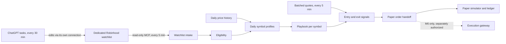

# M5 design: watchlist-driven rule strategy

**Direction, October 18, 2026.** The owner adopted the strategy/execution split recorded in [AGENTS.md](../../AGENTS.md#project-direction). Every 30 minutes, ChatGPT scheduled tasks under the owner's subscription research equities and maintain a dedicated Robinhood watchlist. This application pulls that list every 5 minutes. It checks each symbol's eligibility, builds a profile from its own market data, assigns a playbook, evaluates entries and exits, and makes the final paper buy/sell decision. No paid LLM API runs in the application.

This replaces the October 17 design, in which an in-app OpenAI model selected, reviewed and sized paper trades. It also replaces a same-day draft in which ChatGPT wrote a file of thresholds to a synced folder. Both are in Git history; this file at commit `7d9946c` holds the AI design.

Owner decisions, October 18:

| Decision | Choice |
|---|---|
| Universe | Eligibility rules in code instead of the fixed 44-symbol allowlist, with a cap of 75 watchlist symbols |
| Symbol removed from the watchlist | No new entries; a held position keeps running its exit rules |
| Costs | Model realistic costs instead of the 1% per-fill fee |
| Sizing | Fractional shares; maximum position about 20% of paper equity |

October 19 runtime checkpoint: the owner deployed `80225da`, including the deterministic signals and risk/cost/paper handoff code and migrations `000023`/`000024`. The rule eligibility policy replaces the fixed list for candidate assessment, and external-order detection and paper action accounting are enabled. The signal execution policy remains unapplied; signals, paper fills/handoff, AI and live writes remain off, with $500 cash and no paper positions. A subsequent source increment adds first-minute bid opening valuations and batched collection behind separate default-off gates; its migration `000025` is pending deployment. [Current evidence and limits](M5-OPENING-AND-BATCH-COLLECTION-EVIDENCE.md).

October 20 historical research update: the existing replay engine now supports bounded [historical SIP quote scenarios](M5-INTRADAY-REPLAY-EVIDENCE.md), with raw pre-session profiles, five-minute decisions, later-source fills and shared risk/cost/fill math. First CRM/MSFT session trial completed; source is not deployed, and historical earnings/eligibility and overnight carrying remain limitations. It does not enable execution or prove an edge.

## Roles and data flow

Data moves one way. ChatGPT supplies symbols only, with no prices, thresholds or sizes. Every number used in a decision comes from the app's own data and the owner's versioned settings. The app never edits a watchlist.

Owner direction that still applies: long-only, multi-day to multi-week positions in US stocks and ETFs; no options, shorts, borrowing, leveraged/inverse products or crypto; an instrument with unknown classification is ineligible. A 5-minute cycle checks triggers and stops; it does not mean intraday trading.

## Watchlist intake

- **Lists and roles (owner decision, October 19).** The owner's ChatGPT tasks maintain three lists and move symbols between them. "Core candidates" and "Growth opportunities" (researched candidates to evaluate for a trade now) **nominate**; "Awaiting price or evidence" is **data-only**: its symbols get history and profiles collected in advance but never nominate. Membership is never a buy signal. Every configured list is read in one session into one revision; any failed list fails the whole read. The 75-item cap applies separately to nominating and to data-only lists. Each list's identity is pinned per settings version.
- **Source.** Originally one dedicated Robinhood watchlist (now up to five, with roles), named in a versioned owner setting and separate from personal lists such as "On Watch". It is read with the existing read-only tools (`get_watchlists`, `get_watchlist_items`) through `RobinhoodWatchlists`. The app never edits watchlists.
- **Cadence.** Every 5 minutes, with a separate default-off enablement flag.
- **Revisions.** Each successful read becomes an immutable revision: members with their object types, a hash, and the retrieval time. Robinhood supplies no source time for watchlists, so the retrieval time is the only time. Each successful read, including an unchanged hash, retains a new revision with its own retrieval time, as required by AGENTS.md. The hash and original change time distinguish successful revalidation from membership churn.
- **Cap.** A list with more than 75 items is rejected as a whole and raises an incident.
- **Non-equity items.** Items that aren't equity instruments are skipped, with a recorded reason. They don't invalidate the list.
- **Failed or rejected reads.** The last valid revision stays in use for at most 30 minutes, one ChatGPT cycle. After that there are no new entries until a read succeeds. Exits and risk checks never wait on the watchlist.
- **Removal.** A removed symbol gets no new entries; a held position keeps running its exit rules. A symbol that returns is treated like a new one.
- **Quiet list.** A list unchanged for two trading days raises an informational alert that the strategy tasks may have stopped. It doesn't block trading, because an unchanged list can be legitimate.
- **External orders.** The ChatGPT tasks' Robinhood connection may be able to place orders, and the app cannot prevent that. Any order in the agentic account that the app did not create is an incident and pauses new entries until the owner reviews it. Monitoring already reads orders. Default-off source detection now retains immutable observed equity-order cases and per-order authenticated reviews. Before M6 there is no agentic submission boundary, so all observed orders require review. Acknowledgment and empty reads cannot dismiss a case. The gate blocks watchlist nominations and real-data paper buys; held-position exits remain independent. See [implementation evidence](M5-EXTERNAL-ORDER-EVIDENCE.md).

## Universe and eligibility

Membership nominates a symbol; code decides whether it is eligible. Each check records a reason, and unknown fails closed:

- US-listed stock or ETF, with the existing two-source classification: a fresh Robinhood type plus SEC evidence that it isn't leveraged or inverse.
- Tradable on the account (existing tradability read).
- No unreconciled corporate action (existing clearance).
- Price, liquidity and spread minimums (parameters below).
- Enough daily history to compute a profile.

This replaces the fixed `allowed_symbols` list, with the 75-symbol cap applying to the watchlist itself. October 19 source now supports an explicit separately versioned watchlist-rule policy, stored-data assessments and paper-buy boundary checks. Runtime choices are unchanged; no policy was applied. Reviewed listing evidence and a daily-history/liquidity source remain unavailable, so no symbol can pass the full rule set yet. [Implementation and exact gaps](M5-RULE-ELIGIBILITY-EVIDENCE.md).

## Market data

- **Quotes every 5 minutes.** Read quotes for all watchlist symbols plus holdings in batches, within one MCP session per cycle. `get_equity_quotes` accepts a list of symbols; the source batch collector now uses bounded chunks of five (local ceiling 25), with exact-symbol enrichment and a shared session. Its separate gate is still off. `mcp:cadence-report` measures a session from stored records; the October 19 baseline under the older rotating collector was a median 45-minute per-symbol refresh, so full-universe cadence must be measured after the batch collector is enabled ([evidence](M5-REPLAY-FRACTIONAL-CADENCE-EVIDENCE.md)). Cache the tool catalog per session and store it only when it changes. Respect `Retry-After`.
- **Daily history.** Profiles need at least one year (252 sessions) of split-adjusted daily bars per symbol and for SPY, refreshed after each close and backfilled when a symbol joins. Done in source October 19: split-adjusted SIP daily bars and US-listing evidence from Alpaca ([evidence](M5-MARKET-REFERENCE-EVIDENCE.md)). Originally: the app had no reviewed daily-bar source. Alpaca's market-data API is the leading candidate, since the owner's keys already work for corporate actions. Verify the feed, history depth, adjustments, rate limits and terms first. No subscription is authorized by this document.
- **Earnings dates.** Done in source October 19 from Robinhood's market-wide calendar ([evidence](M5-EARNINGS-EVIDENCE.md)). Originally: the Robinhood catalog advertised earnings data without a reviewed mapping. Review it or select another source. An unknown earnings date blocks new entries.
- **Order-time freshness.** The handoff reads a fresh quote immediately before creating an order. The 20-second quote-age limit applies to that read.
- **Calendar.** Done in source October 19: daily Alpaca calendar refresh ([evidence](M5-CALENDAR-AND-PROFILES-EVIDENCE.md)). Originally: session data is loaded by hand and expires after seven days. Automate loading from a reviewed source, or alert well before expiry.

## Strategy

The approach is trend-following swing trading with strict risk control. The edge it seeks is modest: trade only symbols in established uptrends when the overall market is healthy, enter on defined setups, cut losers quickly, and let winners run under a trailing stop. It must prove itself in replay and forward paper results before anyone relies on it.

**Daily symbol profile.** Computed after each close from daily history, and when a symbol joins:
- trend: close against the 50- and 200-day simple moving averages
- relative strength: 126-session return against SPY
- volatility: 14-day average true range (ATR), as a share of price
- liquidity: 20-day average dollar volume
- next known earnings date

Each profile is versioned with an input fingerprint.

**Market filter.** New entries only while SPY's daily close is above its 200-day average. When the filter is off, exits continue as normal.

**Playbook assignment.** One per eligible symbol per session, with a reason code:
1. **Breakout:** uptrend, strong relative strength, and a tight 20-session range.
2. **Pullback:** uptrend, strong relative strength, and a close near the 20-day exponential average while still above the 50-day average.
3. **No trade:** everything else, including downtrends, excessive volatility, low liquidity, approaching earnings or missing data.

**Entries.** Every 5-minute cycle in a regular session, the app checks the symbol's playbook trigger against a fresh ask. No entries happen in the first 15 minutes after the open, or when the spread is too wide. Each symbol has one position at most, with no adding to losers and no re-entry during the cooldown.

**Exits.** Checked every cycle against the bid. Whichever comes first:
- initial stop below entry
- trailing stop under the highest close since entry, which only rises
- daily close below the 50-day average
- time exit if the trade hasn't progressed
- the last session before a known earnings report

Exit orders are repriced each cycle while the exit condition holds, until filled or the session ends.

**Sizing.** Quantity = (paper equity × risk per trade) ÷ (entry − initial stop). It is capped by the 20% maximum position, available cash after estimated costs, and the maximum number of open positions. Robinhood's reviewed agentic order contract allows fractional quantities only on regular-hours market orders (up to 6 decimals, $1 minimum); fractional limit orders are unsupported, so new execution settings cannot request them. Quantities stay whole shares on limit orders, and a trade that sizes to zero is recorded as skipped, unless the owner adopts guarded fractional market orders ([evidence](M5-REPLAY-FRACTIONAL-CADENCE-EVIDENCE.md)).

**Costs.** These replace the 1% per-fill fee:
- the broker's actual stock/ETF commission (Robinhood's is $0; verify against its current fee schedule)
- SEC Section 31 and FINRA trading activity fees on sells, at versioned published rates
- buys filled at the ask and sells at the bid (already implemented)
- the owner's 1 bp adverse slippage

The legacy simulator contract charges its saved assumptions on both sides. October 19 source adds separately owner-applied dated listed-equity fees for new signal-linked orders, including sell-only SEC fees, the current TAF pause and CAT charges. Historical orders retain their original assumptions. [Cost sources, risk limits, paper handoff and remaining coverage](M5-SIGNAL-PAPER-HANDOFF-EVIDENCE.md).

### Starting parameters

These are versioned owner settings, editable in the Control Center within bounds set in code. Values marked "owner" are decisions already made; the rest are starting points to validate in replay before forward paper evaluation.

| Parameter | Starting value |
|---|---|
| Watchlist cap | 75 symbols (owner) |
| Failed-read grace | 30 minutes |
| Market filter | SPY close above its 200-day average |
| Minimum price | $5 |
| Minimum liquidity | $10 million 20-day average dollar volume |
| Maximum spread at entry | 0.5% of the midpoint |
| Uptrend | Close above the 200-day average, and the 50-day above the 200-day |
| Relative strength | 126-session return above SPY's |
| Volatility cap | ATR(14) at most 6% of the close |
| Earnings blackout | No entry within 5 sessions before a known report |
| Pullback setup | Close within 1× ATR of the 20-day exponential average |
| Pullback trigger | Ask above the prior session's high |
| Breakout setup | 20-session high-low range at most 3× ATR |
| Breakout trigger | Ask above the 20-session high, but not more than 0.5× ATR above it |
| Initial stop | Entry minus 2× ATR |
| Trailing stop | Highest close since entry minus 3× ATR |
| Time exit | 20 sessions without a close at least 1× ATR above entry |
| Risk per trade | 1% of paper equity |
| Maximum position | 20% of paper equity (owner) |
| Maximum open positions | 8 |
| Re-entry cooldown | 5 sessions after an exit |
| Daily loss pause | 20% (owner, unchanged) |
| Slippage | 1 bp (owner, unchanged) |
| Limit offset | 5 bp (owner, unchanged) |

## Signals and handoff

October 19 source update: the independently default-off signal runner now records deterministic entry/exit evaluations from stored inputs, with atomic five-minute cycles and authenticated history. The owner deployed its separate default-off signal paper handoff with explicit risk/cost settings at `80225da`; it remains inactive. For `swing_signals_v1`, stop multiples and the progress threshold pin ATR at the opening signal; trailing levels never decrease, including after revised history, and triggered exits latch until the episode closes. Exits require an actual paper fill linked to the opening signal; broker/legacy holdings are not automatically adopted. [Implementation, verification and remaining limits](M5-STRATEGY-SIGNALS-EVIDENCE.md).

- A signal records symbol, side, playbook, rule and parameter versions, watchlist revision, profile version, an input fingerprint (stored observation IDs and times) and the cutoff. It is unique per symbol, rule and cycle, so restarts and duplicate workers cannot double-signal.
- Only data stored locally before the cutoff counts. Stale or missing inputs produce an `unavailable` result with a reason, never a signal from a guessed value.
- A signal is not an order. `PaperOrderHandoff` changes to accept signals instead of AI decision runs. It sizes from the rules above and stops reading `target_weight_pct` and `allow_ai_sizing`. It keeps the open-order, provenance, freshness, session, limit-offset and fractional checks, and `OfflineSimulator::admission`.
- Paper fills run on the 5-minute cycle instead of only through `mcp:paper-fills`.

## Existing M5 components

| Component | Under this design |
|---|---|
| Applied mandate, paper policy, execution settings, $500 ledger | Kept. New versions replace `allowed_symbols`, `fee_bps`, `max_position_pct` and `allow_ai_sizing` with the settings above. |
| `RobinhoodWatchlists`, `mcp:watchlist` | Kept; becomes the intake source, with the list name from settings and the 75-item cap |
| Control Center drafts, history and restore | Kept. Adds watchlist revisions, per-symbol eligibility, profile and playbook views, and the strategy parameter editor. |
| SEC classification, tradability, corporate actions, readiness | Kept as eligibility inputs |
| Read-only collector | Replaced by the batched 5-minute cycle |
| `PaperOrderHandoff`, offline simulator, real-data fills | Kept; handoff refactored to signals, and the simulator gains sell-only regulatory fees |
| `DecisionRunner`, `PaperDecisionJob`, `DecisionSchema`, `mcp:paper-decisions` | Superseded. Keep disabled and do not extend; remove in a planned change. |
| M3 research (`ResearchRunner`, OpenAI transport, budget ledger) | Superseded for continuous use; keep disabled. Evidence entry, theses and deterministic summaries work without AI. |
| Legacy crypto order path (`TradeExecutionService`) | Do not use; candidate for removal |

## Simulation and evaluation

Use a dedicated paper portfolio/ledger keyed to the local authorized connection and policy version, without writing simulated orders/fills into broker-confirmed ledgers. Starting capital, initial holdings and any sleeve allocation must be explicit. A hypothetical starting portfolio must never be described as actual broker holdings or spendable funds.

Use exact decimals, atomic reservations and unique logical signal/order/fill keys. Model submission, open, partial, filled, cancelled, rejected and expired states. Limit prices, fractional eligibility, available volume assumptions and session rules constrain fills. Absence of usable later observations leaves an order unfilled/unknown rather than generating a synthetic price or pretending liquidity is known. Unsupported corporate actions pause affected simulation pending explicit adjustment evidence.

Inputs must have been available locally by the evaluation cutoff, not merely carry an earlier publication timestamp. Evaluate hypothetical fills only on observations available after order acceptance; data used to produce a signal cannot also prove a later fill. Broker fills and paper fills remain separate on every report.

**Replay.** Once daily history is stored, replay the strategy over it to check the starting parameters before forward paper trading. Daily bars only approximate 5-minute triggers and fills, so use conservative assumptions and label replay results separately from forward results. `mcp:strategy-replay` now uses `daily_replay_v2`: opening exits precede entries, intraday exit proceeds/capacity wait until the next session, sizing reflects opening losses, and warm-up history is excluded from the requested performance window. The first v1 real-data results and sensitivity comparisons are superseded by these October 20 corrections. The corrected real-data rerun (2023-10-20–2026-10-19, 23 current nominated symbols) returned +5.1480% at $500 and +24.2168% at $10,000, with 6.1421% and 10.4486% maximum daily-mark drawdown; SPY price buy-and-hold returned +79.9333%. These selected-universe daily approximations do not establish an edge. The starting parameters remain unchanged ([evidence](M5-REPLAY-FRACTIONAL-CADENCE-EVIDENCE.md)).

**Forward paper evaluation.** Report results after costs, drawdowns, hit rate, average win and loss, holding periods, turnover, skipped and unavailable evaluations, and watchlist churn. Attribute every result to playbook, rule and parameter versions. Compare against buying and holding SPY, and against an equal-weight portfolio of the eligible watchlist. Judge only after at least 30 closed trades. A short profitable sample is not evidence of an edge and cannot enable live mode.

## Costs and budget

No paid LLM API runs in this application. The earlier $100 target / $150 maximum monthly envelope now covers data only, and any paid data source needs explicit owner approval. The ChatGPT subscription is outside the application's budget.

## Implementation order

1. **Broker read efficiency.** One MCP session per cycle, cached tool catalog, batched quotes, `Retry-After` in collection, throttles on broker-read web routes, and no row lock held during the token-refresh request. Source done October 18 and included in the verified October 19 deployment; live full-universe cadence is still unverified ([evidence](M5-BROKER-READ-EFFICIENCY-EVIDENCE.md)).
2. **Watchlist intake and eligibility.** Dedicated list, revisions, cap, failed-read grace, removal handling, external-order detection, and code eligibility replacing the fixed allowlist.
3. **Market data.** Batched 5-minute quotes, a reviewed daily-history source, an earnings-date source, and calendar automation or expiry alerts.
4. **Profiles, playbooks and replay.** Daily profiles, the market filter and playbook assignment; replay over stored history to check the starting parameters.
5. **Signals, sizing, costs and handoff.** Entry and exit signals, risk-based sizing with verified fractional support, realistic costs, signal-based handoff, scheduled fills, the Control Center parameter editor, and owner-applied replacement settings.
6. **Retirement.** Remove the superseded AI decision code and the legacy crypto live order path in planned, tested changes.
7. **Forward paper evaluation.** M6 stays separate.

## Open items

| Item | Safe behavior until resolved |
|---|---|
| Save the three lists and roles in the Control Center | Resolved in runtime: two nominating roles and one data-only role |
| ChatGPT tasks set up so they cannot place trades, if Robinhood allows it | External-order detection still pauses entries |
| Daily-history source and any cost | Deployed: Alpaca using existing keys; no new feed added by opening valuations |
| Earnings-date source | Deployed: Robinhood `get_earnings_calendar` ([evidence](M5-EARNINGS-EVIDENCE.md)) |
| Fractional support verified: market orders in regular hours only; fractional limits unsupported (October 19) | Whole shares on limit orders; zero-size trades skipped; guarded fractional market orders need an owner decision |
| Current commission and regulatory fee rates verified | Dated Q4 2026 preset implemented/deployed; owner signal-policy application remains outstanding |
| Starting parameters confirmed by the owner after replay | Values stay versioned starting points |

## Required failure tests

- Watchlist read failures and expiry of the grace period; over-cap lists; non-equity items; a symbol removed while held and later re-added; an order the app did not create.
- Missing history or earnings dates; a split inside the history window; stale or missing quotes and calendar; broker 429 responses.
- Two workers on the same cycle; restart mid-cycle.
- Unfilled and repriced limit orders; partial and duplicate fills; unsupported fractional quantities; regulatory-fee rounding; unsupported corporate actions.
- Strict separation from broker-confirmed state.

Every unavailable, rejected or skipped outcome remains visible.

October 20 research continuation: [multi-session quote replay](M5-MULTISESSION-REPLAY-EVIDENCE.md) and a [strategy experiment register](STRATEGY-EXPERIMENTS.md) now preserve dated hypotheses, fixed comparisons, source/input versions and both inconclusive and superseded outcomes. The current real two-session sample has zero closed trades and establishes no edge. These source-only research tools neither apply parameters nor activate signals or execution.

October 20 experiment orchestration: the [durable runner](M5-EXPERIMENT-RUNNER-EVIDENCE.md) makes historical processing application-owned. Prompts can submit a bounded JSON specification or read its UUID report; PHP owns acquisition, replay, verification and comparisons. Definitions/settings/source hashes and checkpoints are persisted; rebuilds create new experiments using frozen parent data. No model runs in the worker, parameter variants cannot apply policy, and research does not authorize trading. Source-only migration `000027` and default-off worker activation remain pending.
